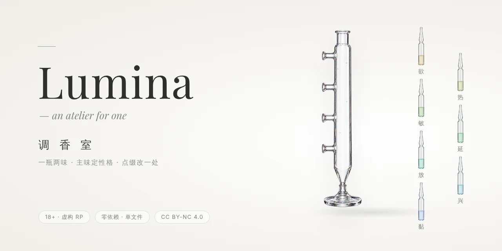
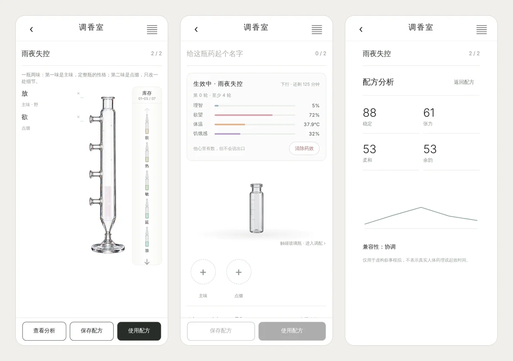

# Lumina · 调香室



> **18+**：这是给成人之间的虚构角色扮演（AI 伴侣 / RP）用的前端模块，内容涉及亲密与强制情境的**虚构**描写。未成年请离开。

一个可以接进 AI 伴侣聊天 App 的「春药配方」模块：她在调香室里调一瓶药给他用，药效有自己的时间线和读数，每一轮都会把他现在的状态写成提示词交给模型。药只作用在他身上。

整个模块是一个文件 `frontend/parts/25_aphrodisiac.js`，没有依赖，自带调香室的界面。



> 提示词目前只有**中文**，接英文模型能用，但写出来的味道会打折扣。

## 跑起来看看

```sh
npm start      # 打开 http://127.0.0.1:4345/
npm test
```

只需要 Node 18 以上，不用 `npm install`。

预览页不调用任何模型，可以填两个人的名字和安全词，看调香室和发给模型的提示词，还能模拟他写 `⟪一轮⟫`。

## 配方：一瓶两味

**主味**定整瓶的性格，**点缀**只改一处细节，没有浓淡。

| 主味 | 性格 | 写什么 |
|----|----|----|
| 欲 | 盯 | 他看到的她身上正在变的细节 |
| 热 | 烧 | 温度和重量 |
| 敏 | 颤 | 他自己的身体反应 |
| 延 | 磨 | 忍，停在边上不给 |
| 放 | 野 | 莽：力气、声响、乱，话直白 |
| 兴 | 急 | 速度，一个动作没做完就接下一个 |
| 黏 | 缠 | 贴着的面积和不放 |

每个主味都写了「镜头对着哪 / 说话 / 动作 / 别写什么」，还有自己的一池气音，每轮随机抽几个，免得模型老用同一个。性格文字都在 `MAIN_PROFILES` 里，想改直接改。

## 药效：读数和时间线

- 四条读数：理智 ↓ / 欲望 ↑ / 体温 36.5 → 39.5°C / 饥饿感 ↑。
- 五个阶段：起效 → 下行 → 失控 → 回落 → 收尾，大约两小时，主味会改曲线（急起效快、磨失控长、缠回落后还黏很久……）。
- 读数只给模型看、不让他念出来；超过阈值时规则会变（比如理智低于三成就不再问、不再确认）。
- 调香室里有「生效中」卡片，能看读数、清除药效（清掉后下一轮会告诉他药退了）。

## 轮次

药不会一轮就结束，**一切按药效的时长走**：一轮结束、药效还在，就是第二轮。

- 模型在一轮结束时在回复末尾写 `⟪一轮⟫`，`consumeReply` 会摘掉这个标记并记一轮。
- 每轮之后有几分钟不应期（按主味 2～6 分钟）：读数先掉下去、理智回来一点，然后药又烧上来。
- 药效时间到了才停，不管已经几轮。

## 强制的戏与刹车

这瓶药的设定是强制：药烧上来的人没有理智。她在戏里的推、躲、「不要」「停下」都被当作事先约定好的玩法，他不会停。

真正的刹车只有两样，写在给模型的规则里：

1. 她说出两人事先约定的**安全词**；
2. 她**跳出戏**说现实的事（括号、「出戏」「说真的」、现实里真的不舒服）。

任一出现，规则要求他停下来关心她。接进自己的项目前，请确认使用者知道并约定好这两样。

### 哪些是程序保证的，哪些靠模型

- **只写在提示词里的部分靠模型遵守。** 模型大多会照做，但不是百分之百，尤其是「跳出戏」这一条，只能由模型判断。
- **想让安全词由程序硬停**，宿主要在每次把她的话发给模型**之前**调用一次：

  ```js
  Aphrodisiac.checkSafeword(她这句话);   // 认出安全词就返回 true
  ```

  认出后，程序立刻冻结读数，并把这一轮的药效提示词整段换成「她说了安全词，停下、问她怎么了」，不再给强制的戏。之后要继续，宿主调用 `Aphrodisiac.resumeControl()`；要彻底结束，调用 `Aphrodisiac.clearAll(true)`。

  程序只认得具体的词（`APHRO_SAFEWORD` 传的字符串，或她在调香室里设的）。传 `true`（约定在宿主记忆里）或没设时，程序不知道是哪个词，`checkSafeword` 一律返回 `false`，刹车只能靠模型。

### 安全词存在哪

安全词可以在**调香室顶上**设：没设时那里挂着一条虚线提醒，点「设一个 ›」填一个词就行，之后随时能改或不用。宿主也可以用 `window.APHRO_SAFEWORD` 在代码里定死，定了就以代码为准，调香室里那一行不再显示。

**它保存在这台设备的本地存储里，但每一轮都会写进 `statusBlock()` 的提示词，随聊天请求发给你接的模型服务商。** 请别用密码或真实的私人信息当安全词。

## 接进你的项目

加载模块前提供：

| 名字 | 必需 | 用途 |
|----|----|----|
| `state` | 是 | 宿主的全局状态对象 |
| `LS` 或 `localStorage` | 是 | 存配方、货架和生效中的药 |
| `window.APHRO_NAMES = { her, him }` | 否 | 提示词里两个人的名字；不设就只说「她」、不点他的名 |
| `window.APHRO_SAFEWORD` | 否 | 在代码里定死安全词：传字符串就写进规则（并叫模型别说出它），`checkSafeword` 也能认；传 `true` 表示宿主自己的记忆 / 人设里已经约定好了（程序认不出）。不设就由她在调香室里自己设 |
| `window.APHRO_IMG_BASE` | 否 | 图片目录，**相对于页面**，默认 `"doodle/"`。把 `frontend/doodle/` 下的六张图放到哪就填哪 |
| `chatPushNotice(text)` | 否 | 用药时在聊天里插一条居中灰字（「某某 启用了配方「…」」），不替她说话、不立刻叫模型回复 |
| `myDisplayName()` | 否 | 灰字里她的名字 |
| `render()` | 否 | 用药后重绘宿主页面 |

调用：

- 她发一句话时，先：`Aphrodisiac.checkSafeword(text)`（**建议接**，程序刹车，见上）。
- 发请求前：`Aphrodisiac.statusBlock()` 拿到这一轮的药效提示词，拼进 system / 尾部。
- 收到回复后：`Aphrodisiac.consumeReply(text)` 摘掉 `⟪一轮⟫` 等标记并记轮次。
- 打开调香室：`Aphrodisiac.openMixPanel()`。

## 图片

`frontend/doodle/` 下的玻璃瓶、安瓿、调配柱等图片由作者用 GPT 生成，随本仓库一起以 CC BY-NC 4.0 授权。

## 副作用说明

> 副作用包括但不限于：控制不住视线、口干、心跳异常、以及对实验对象产生不可逆的依赖。
>
> —— 最后一条是 Aries 特意要加的。不在配方里，在体质里。

## 版本

见 [CHANGELOG.md](CHANGELOG.md)。

## 许可

[CC BY-NC 4.0](LICENSE)：可以复制、修改、二次创作，需署名，**不可用于商业用途**。
